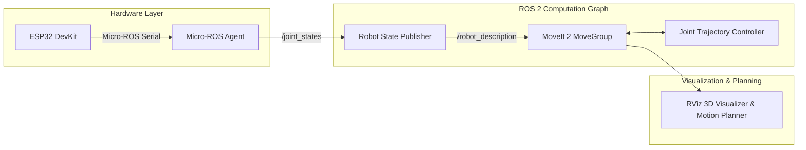

# Hercule 6-DOF Robotic Arm: ROS 2 & Micro-ROS Platform

An open-source industrial robotics control and simulation platform for a 6-DOF robotic manipulator, featuring **ROS 2 Humble**, **MoveIt 2 motion planning**, and **ESP32 Micro-ROS serial telemetry**.

---

## System Architecture



---

## Repository Structure

```text
Hercule-Robotic-Arm/
├── firmware/
│   └── esp32/
│       ├── platformio.ini       # PlatformIO configuration (micro-ROS transport & deps)
│       └── src/
│           └── main.cpp         # 6-joint state publisher over serial micro-ROS
├── ros2_ws/
│   └── src/
│       ├── my_robot_arm/
│       │   ├── urdf/arm.urdf    # 6-DOF robot kinematic URDF model
│       │   ├── config/arm.rviz  # RViz display profile
│       │   ├── launch/          # Robot display launch scripts
│       │   └── my_robot_arm/    # Inverse kinematics solver node
│       └── my_robot_arm_moveit_config/
│           ├── config/          # SRDF, joint limits, kinematics, controllers
│           └── launch/          # MoveIt 2 demo and execution launches
└── README.md
```

---

## Prerequisites

- **Ubuntu 22.04 LTS** (or WSL2)
- **ROS 2 Humble Hawksbill**
- **MoveIt 2**
- **PlatformIO Core** (for ESP32 firmware flashing)

---

## Getting Started

### 1. Build the ROS 2 Workspace

Open your ROS 2 environment:
```bash
cd ros2_ws
colcon build --symlink-install
source install/setup.bash
```

### 2. Launch the MoveIt 2 Motion Planning Demo

To launch RViz with interactive MoveIt motion planning:
```bash
ros2 launch my_robot_arm_moveit_config demo.launch.py
```

### 3. Flash the ESP32 Firmware

From the `firmware/esp32` directory:
```bash
cd firmware/esp32
pio run -t upload
```

### 4. Run the Micro-ROS Agent

To bridge the ESP32 microcontroller into the ROS 2 graph over serial:
```bash
ros2 run micro_ros_agent micro_ros_agent serial --dev /dev/ttyUSB0 -b 115200
```

---

## License

This project is licensed under the Apache 2.0 License.
